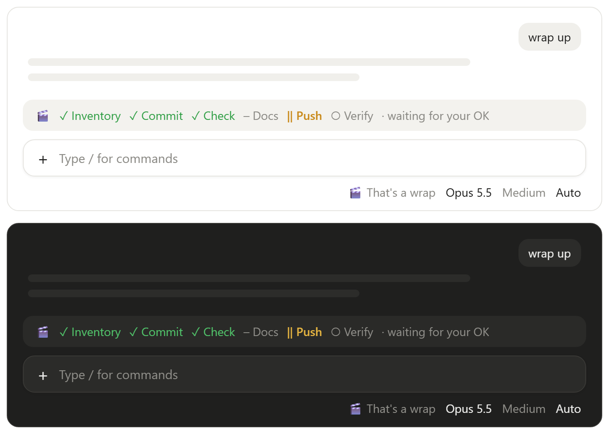
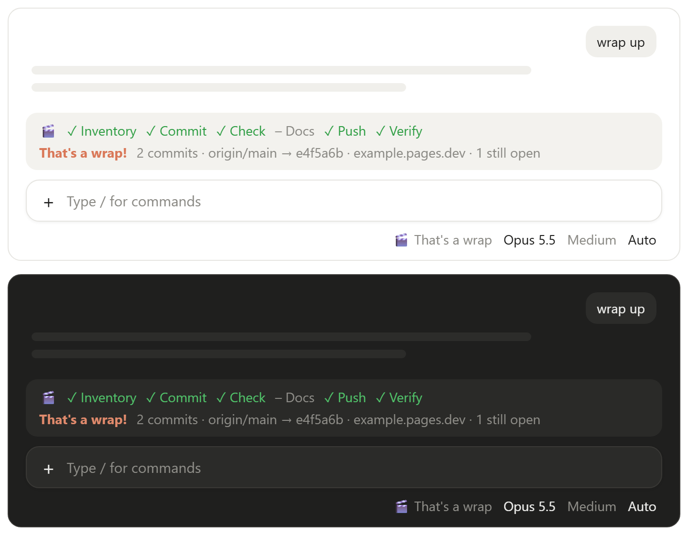

# 🎬 That's a wrap

**Say "wrap up" and Claude Code finishes the conversation's work — commit, check, docs, push, deploy, verify — and stops for your OK before anything leaves your machine.**

<p align="center">
  
</p>

Start it by saying "wrap up", pressing **🎬 That's a wrap** next to the model name, or typing `/thats-a-wrap:wrap-up`.

## What it does

1. **Takes stock** — what this conversation changed, and anything elsewhere you may have forgotten: other sessions' uncommitted changes, other worktrees, unmerged branches.
2. **Commits** this conversation's changes, one commit per feature. Other sessions' work is listed, never swept in.
3. **Checks for bugs** with your project's tests, or a syntax check and diff review.
4. **Syncs docs and lessons** — README, repo description, and this session's pitfalls into `CLAUDE.md`.
5. **Pushes and deploys** after you OK a checklist — public checks, private archives, Cloudflare and CI deploys included when your project has them.
6. **Verifies and cleans up** — remote matches local, the site responds, temp files go.

Progress shows in a bar above the prompt while it works; the bar has that spot to itself until you send your next message. When it is done the credits roll, with a soft *swoosh*:

<p align="center">
  
</p>

## Every project gets its own wrap-up

The first time you wrap up in a project, Claude asks once what else it needs — bump the version, update the changelog, cut a GitHub release, publish a package, skip the stop before pushing — with options taken from what is actually in the project. Your answers are saved as a `## Wrap-up` section in that project's `CLAUDE.md` and used from then on. When the project later grows something the section doesn't cover, Claude asks once; what you decline is recorded as `Not doing` and never asked again.

A section looks like this:

```markdown
## Wrap-up
- Tests: `npm test`, then `npm run e2e`
- Push: `origin` (public), after `node scripts/check-public.js` passes
- Deploy: `npx wrangler pages deploy dist` → https://example.pages.dev
- After step 2: bump the version in package.json
- Not doing: GitHub releases
```

## Install

At the prompt of a terminal session:

```
/plugin install thats-a-wrap --marketplace FxrcRed/claude-thats-a-wrap
```

From a shell:

```
claude plugin install thats-a-wrap --marketplace FxrcRed/claude-thats-a-wrap
```

In the desktop app: click **+** next to the prompt box → **Plugins** → **Add marketplace** with `FxrcRed/claude-thats-a-wrap` → **Add plugin**.

## License

MIT
